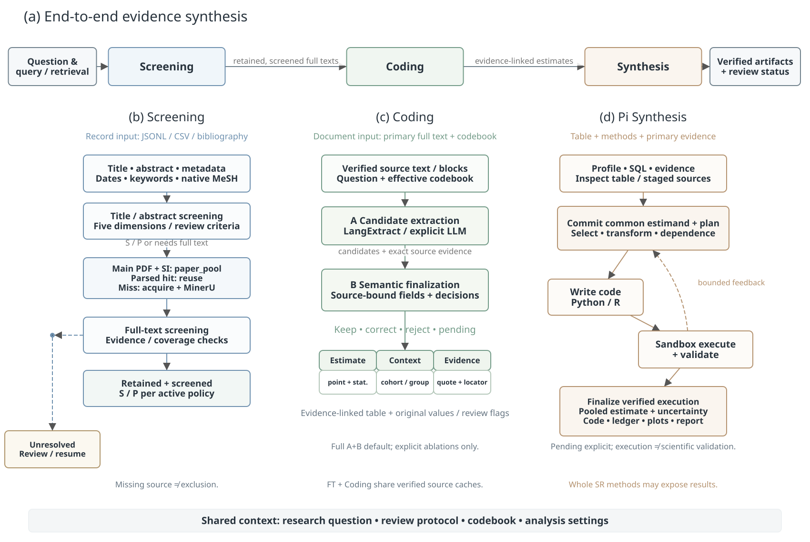

# MetaAgent-Epi 方法

## 1. 任务与框架

MetaAgent-Epi 面向流行病学参数的系统综述，依据研究问题和纳入与排除标准（以下简称纳排标准），完成文献筛选（Screening）、参数提取（Coding）和综合分析（Synthesis）。三个模块共享研究问题与纳排标准，依次确定相关文献、提取原文估计，再选择可共同分析的估计计算综合结果。

一篇文献可以包含多个估计。我们用一条估计记录保存特定参数在某个人群、组别和时间范围内的统计量、数值及来源。研究队列指同一批研究对象。一个研究队列可产生多条估计，综合分析时需处理这些估计之间的关联。

**图 1. 端到端流程。** 题名与摘要筛选后获取正文与补充材料，复用文本缓存或使用 PDF 解析工具 MinerU 转为文本。参数提取依次生成候选记录并核查原文。综合分析统一分析范围、统计量和单位，编写代码、执行计算并核验结果。三个模块均可独立运行。[SVG](figures/methods/end_to_end.svg) · [PDF](figures/methods/end_to_end.pdf)。

## 2. 评估基准构建

### 2.1 任务与候选文献

我们以 COVID-19 和 mpox 的已发表系统综述构建评估任务。从原综述正文、补充材料、作者数据及检索说明中，整理研究问题、纳排标准、数据库、检索式、检索时间和纳入文献；进一步记录各项参数分析实际使用的文献、估计及统计方法。

依据原综述记载的检索条件，在可访问的数据库中重新检索，保留查询记录、数据来源和获取时间。自然检索得到的候选文献保存为 `raw_search`。原综述纳入但未检索到的文献另行补充，记录补充依据，与自然候选合并为 `raw_pool`。两组数据分别用于评价自然检索覆盖和固定候选池中的筛选表现。

时间约束保留采用的检索、更新或收稿日期及其精度，并分别记录文献发表、数据库收录及预印本版本日期。

### 2.2 文献核对与信息补全

通过 DOI 等文献编号、PubMed 数据库编号（PMID）、题名、作者及年份核对文献，合并重复记录并保留版本信息。预印本记录明确版本，文献编号或版本存在冲突时标为待核对。

补全可获得的题名、摘要、关键词、医学主题词（MeSH）、出版类型、语言、作者、期刊及日期，保存每项补充信息的来源。模型接收上述文献信息和任务说明，参考标签另行保存，供预测完成后评分。

### 2.3 分模块参考数据

筛选参考记录文献是否被原综述纳入，并另存文献是否符合纳排标准的证据与判断；未经核对的判断标为未知。参数提取参考保存文献中的估计及字段，并注明依据来自原研究、原综述表格或计算推导。

综合分析参考对应原综述中的具体分析，包含实际使用的估计、统计方法、综合点估计及区间。总体分析、亚组分析，以及调整假设后重复计算的敏感性分析分别保存，使预测与对应的参考结果比较。

**图 2. 评估基准构建。** 从原综述恢复任务及参考数据，重建自然候选池并单列人工补充文献。模型预测分别与文献筛选、参数提取和综合分析参考比较。[SVG](figures/methods/benchmark.svg) · [PDF](figures/methods/benchmark.pdf)。

## 3. 端到端执行与模块运行

一份任务配置保存研究问题、纳排标准、检索设置、编码表、提取范围和综合分析要求。编码表规定提取字段的含义与类型，提取范围限定本次关注的参数。各模块接收同一任务中的相应信息。

流程从检索式生成或预设检索式开始，也可读取固定候选池。自动生成查询时，模型依据研究问题、疾病、参数和时间范围生成 PubMed 检索式。系统保存实际查询及各来源的执行状态，随后依次完成题名与摘要筛选、全文获取、全文筛选、参数提取和综合分析。

模块运行从相应输入开始：文献筛选读取候选文献信息，参数提取读取全文，综合分析读取估计记录。研究问题与纳排标准随输入传递。各阶段保存输入、配置、输出及完成状态，供中断后继续执行或复用结果。

## 4. 文献筛选

### 4.1 题名与摘要筛选

模型根据研究问题和纳排标准，分别判断疾病、人群、地区或研究场景、研究类型与数据来源、目标参数是否符合要求。这五个方面分别给出 0–4 分及依据，分数越高表示支持越充分。模型同时将文献分为高度相关（S）、可能相关（P）和不太相关（U）。

参数说明按任务加载，区分病例与感染人数作为分母、研究估计与模型固定输入，以及各类时间间隔的定义。地区判断区分感染来源与采样地点，研究类型判断结合文献内容和任务允许的证据形式。模型在总体理由中核对明确的语言、日期等限制。

模型根据五维分数、判断依据和纳排标准直接给出分类。程序检查五维评分和标签是否完整、格式是否有效；缺少或无效的结果请求模型纠正，仍不合格时记录失败。S、P 文献进入全文获取与筛选。缺少摘要或判断所需信息时，记录信息不足，留待全文确认。

### 4.2 全文筛选与批量处理

全文筛选根据纳排标准确认文献是否保留。系统也支持逐条条件判断：模型为各项条件给出满足、不满足、未知或不适用的状态及原文引文，程序核对引文后，按任务设定的逻辑得出保留、排除或待审结果。运行记录注明采用五维评分还是逐条条件判断。

单次请求可处理一篇文献，也可在同一研究问题下处理多篇文献。每篇保留独立标识，程序核对返回结果是否完整，并记录漏返和失败。批量大小与并发度分别设置。

## 5. 全文获取与解析

系统先检查项目根目录的共享文献池 `paper_pool`，核对已有正文、补充材料及其版本。缺少文件时，通过可用公开来源获取；获取失败或文献无法确认时，记录原因。

系统优先复用与当前 PDF 内容、解析工具版本及设置一致的缓存，未命中时调用 MinerU。文件下载状态与解析状态分别保存，兼容旧缓存时记录其核对状态。

正文和补充材料按文献关联，解析文本分块后交给参数提取模块。每个文本块保留来源及原文位置，供后续核查引用。

## 6. 参数提取

### 6.1 提取字段

参数提取接收全文、研究问题、纳排标准、编码表和提取范围。每条估计记录按字段定义保存以下信息，并关联原文引文与位置。

| 字段类别 | 提取内容 |
| --- | --- |
| 文献与研究对象 | 文献、版本、研究队列及共享研究对象的情况 |
| 参数与统计量 | 参数定义，均值、中位数、比例或计数 |
| 数值与不确定性 | 点估计、单位、置信区间、可信区间、标准差、标准误或四分位距，及适用的区间水平 |
| 人群与组别 | 总体、亚组、研究时期、变异株及观测起止时间的定义 |
| 分析方法 | 统计模型、分布假设、调整因素、样本量、事件数及分母 |
| 证据与状态 | 原文引文、位置及未报告、不适用或待核查状态 |

### 6.2 阶段 A：候选提取

阶段 A 从全文各块中提取估计及上下文，生成候选记录。默认使用 LangExtract，按编码表提取字段并关联原文位置；也可直接调用模型提取。

同一文献中的总体、亚组、时期、统计量和模型结果分别保留。返回空结果时，可在预设次数内再次核查。所有候选记录送入阶段 B。

### 6.3 阶段 B：原文核查

阶段 B 读取候选记录、原文及与阶段 A 相同的任务要求，核对数值、统计量、区间、单位、人群、组别、方法和分母。每条候选记录标为保留、修正、拒绝或待审；原文中发现的遗漏估计可补入，并附证据。

程序检查输出字段、候选记录的处理结果及引文能否在原文中匹配。最终输出估计记录、核查结果、来源清单和待处理信息。`coding_estimates.jsonl` 保留结构化记录及证据，表格导出用于人工审阅。

## 7. 综合分析

### 7.1 确定分析范围和统一口径

综合分析使用 Pi 作为分析代理，负责查询数据、编写代码和调用计算工具。它接收研究问题、纳排标准、估计记录及方法材料，通过字段说明、样例、分页查询和原文检索逐步读取数据。原研究用于核对估计含义及研究对象，原综述或协议用于确定综合方法。

编写代码前，Pi 保存分析计划，明确共同分析的参数、统计量、人群、组别、时间、终点定义、单位和不确定性表示，并列出所选估计、选择理由及重复估计的处理方式。

需要转换的记录保留原值、公式、假设和转换结果。例如，单位转换同时处理点估计与标准误；由置信区间计算标准误需说明区间水平和近似方法，由标准差计算标准误需有适用样本量。中位数或可信区间的转换在计划中单独说明，并通过敏感性分析检查假设对结果的影响。

### 7.2 代码执行与结果核验

Pi 根据计划编写代码，在限制网络和文件访问的隔离环境中执行。程序核对所选估计、转换过程、权重、单位和区间，并重复运行代码检查结果一致性。支持的固定效应和随机效应分析另行复算核对数值。

执行或核验失败时，Pi 根据反馈修改计划或代码，在预设次数和时间内重试。通过核验后，系统保存分析计划、所选估计、转换过程、代码和执行记录，并生成综合报告。

按原综述范围和方法完成的分析标为复现；采用额外假设或不同样本范围的分析标为探索性分析，并给出敏感性分析结果。材料不足以支持计算时，保存待审或不可计算状态及原因。

## 8. 评估与消融设计

模块评估固定上游输入，分别评价候选池中的文献筛选、固定全文的参数提取，以及固定估计记录的综合分析。端到端评估从研究问题和检索设置开始，记录各阶段保留的文献、可获取的全文、提取的估计及最终用于综合的估计。

文献筛选报告已知纳入文献的召回率、已知标签范围内的精确率与 F1，以及成功返回判断的比例。原综述纳入名单的恢复与是否符合纳排标准分别计分，未知标签保留。参数提取按参考数据覆盖范围评价估计的提取完整性、字段正确性和引文位置，并记录缺少全文、未完成提取及待核查的情况。

综合分析比较所选估计、转换过程、统计方法、综合点估计及区间。预设公式的计算与 Pi 生成代码的分析分别报告。使用原综述全文作为方法材料时，其结果内容也可被读取；实验记录所提供材料的版本和内容范围。

消融实验在参数提取模块中比较完整的阶段 A+B、移除阶段 A 和移除阶段 B。移除阶段 A 后，阶段 B 直接从相同全文提取并核查；移除阶段 B 后，保留阶段 A 的候选记录，并标注未执行原文核查。实验对齐模型、编码表、文献版本及预算设置。

批量实验在相同候选和模型设置下比较返回完整性、筛选质量、请求用量与运行时间，同时记录批量大小、并发度和服务共享情况。

---

实现说明见[方法与代码对应关系](design/METHOD_IMPLEMENTATION_MAP.md)，运行命令见 [CLI 使用说明](CLI_MODULES.md)。
